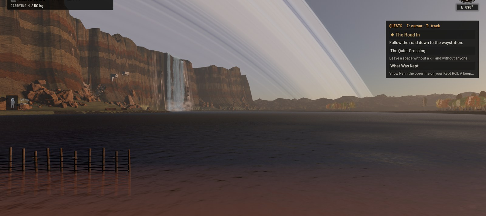
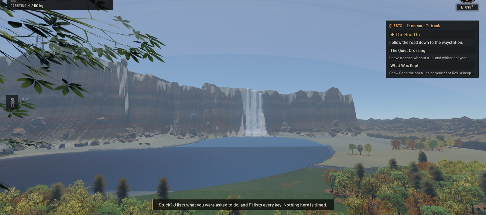
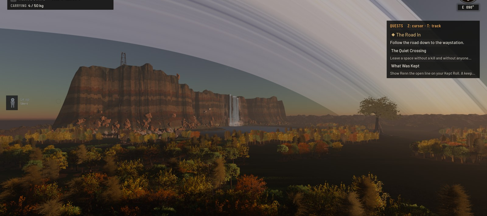
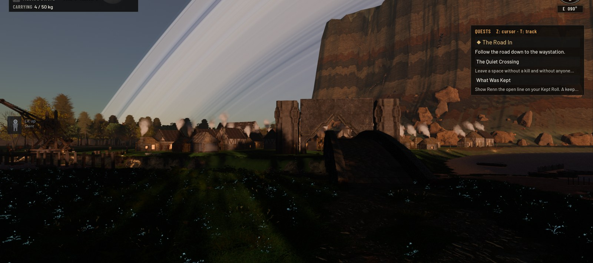
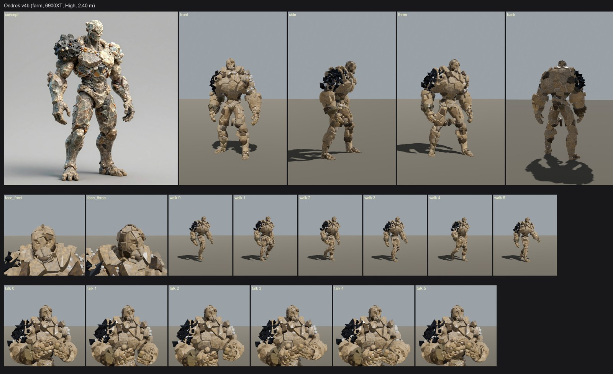
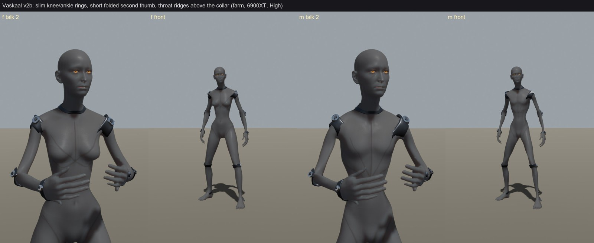
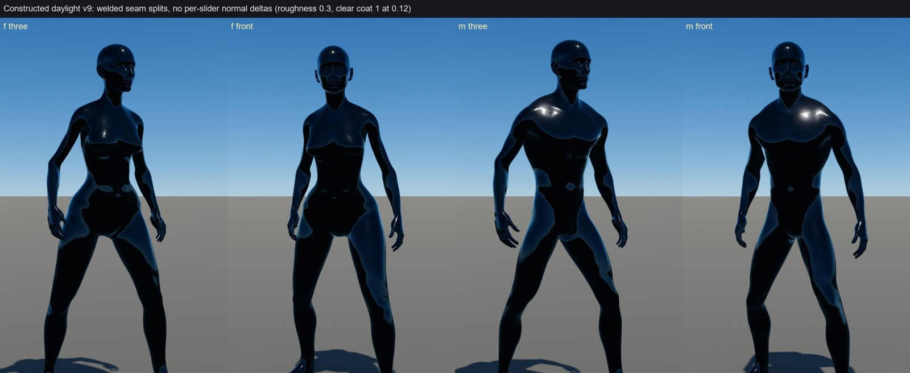

OTHERREACH is a persistent fantasy world built in Godot 4 with C#. It's designed to keep living while you're logged off, where nobody pauses and there are no difficulty presets. We've been heads-down for two months without posting anything, so this first devlog catches up on the bigger pieces.

## The world is becoming one place

Until recently each region was its own level. You walked to an edge, the game saved, and the next region loaded. That worked, but it never felt like a world.

The world is now being joined into **one continuous streamed space**. The Hollow, Kaldrun, the Sedge marshes and the Salt Steps sit in their canon positions, and you can walk between them on foot. The world is cut into 100 m cells. Cells near you are built, cells in the middle distance are kept ready, and cells far away are freed. Models load on a background thread, and the art library counts references, so nothing stays in memory once no cell needs it.

The first full walk, from the Hollow through Kaldrun to the Sedge and on to Tollpiles, works end to end. It is not fast yet: peak video memory came down from 25.8 GB to 18.9 GB this week, and we're aiming for 13. Most of what's left is people. Every villager's body and clothing has to be on the GPU. This week's wins were compressing the whole wardrobe to BC7/BC5 with no visible change (−1.2 GB in the busiest town), and drawing each villager only where their own cell stands.

## Kaldrun: a cliff town under the ring

The east of Kaldrun is a sheer escarpment with a waterfall into a lake. Vessmere, a working town, sits at its foot.

The pale arc in the sky is the world's ring. You can see it from almost everywhere, and it's one of the first things that tells you this isn't Earth.

Vessmere has chimney smoke, lit windows, a wharf, residents with routines, and its own soundscape. It's also where the game's era starts to show.

## Not just "period fantasy"

The everyday world is medieval. Technology exists, though, and it's gated by **who will teach it, what can be salvaged and what it costs**. A flashlight is a luxury in a Veth market town and cheap where the Vaskaal or the Constructed trade. The world steps up in era as you travel. The lift at the top of Vessmere's cliff is Kal engineering: carved basalt with bronze sheaves and landing ledges for a winged people. The iron cranes on the wharf are plainly industrial. Further out, the Salt Steps are "every era at once".

## Four new peoples

The character creator had four playable peoples. Four more existed in the lore but had no bodies. This week they all got one, on the same rig and animation set as everyone else, so they walk, talk and wear gear like any other character.

**The Ondrek** are tall stone-and-quartz people with a crystal growth on one shoulder, strung with pearls.

**The Vaskaal** are lean and grey, with amber eyes and two thumbs on each hand. The mechanical rings at their joints are brace hardware, not anatomy.

**The Constructed** are seamless black lacquer. Getting that finish right under an open sky took most of a day: what looked like reflection artefacts turned out to be split normals at the creator mesh's texture seams.

**The Mor**, the fog people, are still in progress.

## Also this fortnight

- **Combat:** enemies now have minds of their own. They flee when broken and telegraph their techniques before using them.
- **Medicine, downed states and wounds:** these are in, with splints and field treatment.
- **Regional travel** between areas works by waystone.
- **Kaldrun east** now has its creatures, from black bears and elk to the Reach raiders and their captain.

Next up: getting the one-world walk to a playable frame rate, the Salt Steps quarters, and a public playtest.
